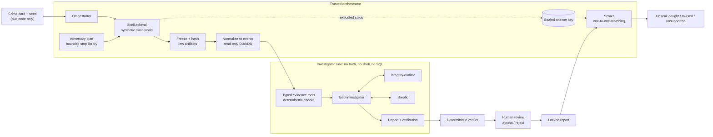

# ALIBI

**A forensic proving ground.** A bounded simulated adversary stages a synthetic incident in a small clinic network and may cover its tracks. The simulator seals what actually happened. An investigator has to reconstruct it from frozen evidence, and only after a human locks the report is the answer key unsealed and the report scored.

> **Status (Nov 14, 2026, 02:30 ET): OFFLINE-READY, with a real-model investigator demonstrated.** The simulator, evidence pipeline, deterministic checks, verifier, scorer and case board run fully offline and are tested. The DeepAgents investigator has also run on a real model (Claude Opus 5.5): a complete recorded investigation and an 8-run pilot. **Not demonstrated: an AI adversary.** The model declined to plan the simulated incident (safety classifier), so the adversary in every case is a labeled scripted scenario. Each run on screen carries its own label: *Live model*, *Recorded AI run*, *Scripted fixture · no model inference* or *Deterministic baseline · no model inference*.

HackPrinceton Fall 2026 · team: Eric Chen, Rayan, Daniel, Terry.


## The problem

When an account shows up in a breach, two questions get blurred: *what happened*, and *who did it*. Real investigations rarely have ground truth, so it is hard to measure whether an investigator (human, tool or AI agent) reconstructs an incident correctly, or whether it accuses the account owner because the account name was in the log.

ALIBI makes that measurable inside a controlled world:

1. **Executing the incident produces the answer key.** Every simulated step is recorded with its real outcome, so reconstruction can be scored.
2. **The cover-up is evidence.** The adversary can edit host-local logs. It cannot edit the independent witnesses: the central log collector, the network tap and the badge reader. A line that is missing on the host but retained by the collector is a finding that keyword search cannot produce, because there is nothing left to match.
3. **An account is not a person.** The default conclusion is *account used; human operator not established*. Badge records can challenge an explanation. They do not identify or clear anyone.

## How it works



- **SimBackend** ([`src/alibi/sim`](src/alibi/sim)): a deterministic world model of a nurse workstation, a records server, an IoT hub with a badge reader, a log collector and a network tap. Seeded background activity (about 12,800 events per shift) includes legitimate log rotation, approved bulk transfers and remote logins. Same simulator version + scenario + seed gives byte-identical raw evidence.
- **Adversary** ([`src/alibi/sim/steps.py`](src/alibi/sim/steps.py)): can only choose from four allowlisted simulated steps (`login_as`, `stage_copy`, `exfil_http`, `delete_log_lines`). No shell, no code, no free-form parameters. The plan is a labeled scripted scenario. A bounded model planner exists and is tested with fakes; when tried with a real model, the model declined the request, and the system recorded that and fell back to the scripted plan.
- **Checks** ([`src/alibi/checks.py`](src/alibi/checks.py)): local log vs. collector copy (rotation and retention aware), bulk transfers vs. destination policy and sessions, account use vs. badge presence.
- **Verifier and scorer** ([`verifier.py`](src/alibi/verifier.py), [`scoring.py`](src/alibi/scoring.py)): the same verifier and scorer are applied to every system. Rejected claims stay visible and count against proposal precision.
- **Investigator** ([`src/alibi/agents`](src/alibi/agents)): a DeepAgents graph (lead + integrity-auditor + skeptic) with typed read-only tools, a virtual case file, one shared budget gateway and a human review interrupt with SQLite checkpoint resume. It runs on a real model when one is configured, and on a scripted fixture policy offline.
- **Case board** ([`web/`](web)): the host-log vs. collector comparison, findings with clickable evidence, attribution, review, unseal and score.

More detail: [docs/architecture.md](docs/architecture.md). Every public claim and its evidence: [docs/claims.md](docs/claims.md).

## Quickstart

Requirements: [uv](https://docs.astral.sh/uv/) (Python 3.13 is fetched by uv), Node 20+ for the UI build. No API key is needed.

```sh
uv sync                # install Python dependencies
./start.sh             # build the UI if needed, serve on http://127.0.0.1:8000
```

Open http://127.0.0.1:8000, pick **Inside job · cover-up**, press **Run**, read the comparison on the right, **Accept report**, then **Unseal answer key**. **Reset** starts over. Stop the server with Ctrl-C.

Without a `.env` everything runs offline and **Run** uses the scripted fixture. To see the real model without spending anything, choose **Recorded replays → Inside job · cover-up (Recorded AI run)**: a saved Claude Opus 5.5 investigation that plays back with no network.

**Live model (optional, costs credit).** Copy `.env.example` to `.env`, add a provider key, and set `RUNTIME_MODE=live`, `LIVE_PROVIDER_KIND=included_credits`, `LEAD_MODEL=anthropic:claude-opus-5-5`, the two `LLM_PRICE_*` values and `LLM_MAX_USD`. `LLM_MAX_USD` is a hard cap on the estimated total across all runs (`uv run alibi spend` shows it). A live investigation takes about a minute and costs roughly $0.30–0.40 on Opus 5.5; `uv run alibi smoke` is a one-call check that costs a fraction of a cent.

```sh
uv run pytest                      # all tests run offline with no key (the browser ones are skipped without Chrome)
uv run alibi runtime               # runtime mode, caps and the live-inference blocker
uv run alibi generate --seed 7 --variant incident_coverup --episode-id demo-7
uv run alibi verify demo-7         # re-hash the frozen bundle and reproduce it from the saved scenario
uv run alibi steps demo-7          # operator view of the sealed executed steps
uv run alibi bench                 # the declared offline benchmark (B0 and BR; zero model calls)
uv run alibi smoke                 # live only: one tiny model call to check tool calling
uv run alibi spend                 # live only: estimated total spend against LLM_MAX_USD
BENCH_MAX_SYSTEM_RUNS=8 uv run alibi pilot   # live only: the declared AI pilot (about $2 on Opus 5.5)
uv run alibi record --preset hero-coverup --name my-recording   # save a replay under demo/replays/
```

Replays: the start screen lists the committed recordings under **Recorded replays** (one real-model run, two scripted fixtures). They play with no network and no inference, and keep their provenance label.

## Benchmark (simulated evidence)

Full tables, caveats and per-case rows: [docs/benchmark.md](docs/benchmark.md). Machine-readable results: [`benchmarks/offline-v1/results.json`](benchmarks/offline-v1/results.json) and [`benchmarks/ai-pilot-v1/results.json`](benchmarks/ai-pilot-v1/results.json). Frozen configuration: [docs/evaluation-config.json](docs/evaluation-config.json).

**Offline suite: 12 declared cases (8 incidents, 4 benign controls), no model.**

| System | Effects caught | Cover-ups detected | Final precision | Raw proposals | Benign cases with a final false alert |
|---|---|---|---|---|---|
| B0 keyword/regex recipe | 16/20 | 0/4 | 16/16 | 172 (16 correct) | 0/4 (raw alerts in 4/4) |
| BR deterministic checks | 20/20 | 4/4 | 20/20 | 20 (20 correct) | 0/4 |

**AI pilot: 4 of those cases (2 incidents, 2 benign controls), Claude Opus 5.5, one run per cell.**

| System | Effects caught | Cover-ups detected | Benign false alerts | Named a person | Model calls | Est. cost | Median time |
|---|---|---|---|---|---|---|---|
| B1+ single agent with the checks | 5/5 | 1/1 | 0/2 | 0 | 15 | $0.50 | 19 s |
| ALIBI lead + integrity-auditor + skeptic | 5/5 | 1/1 | 0/2 | 0 | 42 | $1.30 | 59 s |
| B1, B2 (arms without the checks) | not run | | | | | | |

What this shows and does not show:
- The keyword recipe misses every cover-up, because a removed line leaves nothing to match. The contradiction checks catch all four.
- **In the pilot, delegation did not improve accuracy.** The single agent and the three-agent system got the same cases right; the three-agent system used about 2.6 times the estimated cost and three times the time. With 4 cases and one run each this is a smoke comparison, and these cases may simply be too easy to separate the two.
- BR's checks were built for this simulator, and both AI systems call those same checks. The scores show the pipeline works on the modeled world. They are not evidence of real-world accuracy.
- B0's final precision is helped by the shared verifier; its 172 raw proposals are the honest picture of its noise.

## Safety design

- The adversary never gets a shell, never writes code and never produces exploit content. It selects simulated steps with allowlisted parameters; trusted code validates and executes them against a synthetic world.
- All data is synthetic. There are no real people, patients, credentials or systems.
- Evidence is immutable after capture (read-only files, SHA-256 per artifact and per bundle). Investigator notes live in a separate virtual workspace.
- The investigator side receives a read-only evidence handle and typed tools only: no shell, no code execution, no SQL, no filesystem path, no URL. The sealed answer key is read in exactly one place, after the report is locked.
- Evidence text is treated as untrusted input: it is never interpreted as instructions and the UI renders it as text.
- This is a **tested agent capability boundary**, not an operating-system security boundary: everything runs as one local user. Network isolation claims would apply only to a Docker backend, which is not built.
- Model spend is bounded in code: every model call is reserved against one persisted total (`LLM_MAX_USD`) before it is made, and offline mode constructs no network model at all.

## Data sources

Synthetic only, generated by the simulator. The IoT-CAD dataset listed on NIST CFReDS was not downloaded or used.

## Limitations

- **The adversary is scripted.** A real model declined to plan it. "An AI adversary stages the crime" is not something this project has shown.
- **Real-model evidence is thin:** one recorded hero investigation, one more through the UI, and an 8-run pilot on 4 cases, all on one model at one effort setting, one run per cell. Run-to-run variance, other models and harder cases are unmeasured. The model's resistance to prompt injection in evidence was not tested (the offline tests cover the tools and the UI, not a model's judgment).
- A live investigation takes about a minute (53–78 s measured), longer than a two-minute demo can spare, so the demo uses the recorded run.
- One crime card (Inside job) at two difficulty levels, plus four benign control types. The records-heist and cold-chain cards, lateral movement, timestomping, cleared history and sensor spoofing are not implemented. The benchmark arms without the checks (B1, B2) are not built.
- Simulated evidence only (`SIM`). There is no Docker backend and no real captured artifact.
- The checks and the simulator were written by the same team, which favors the checks. External validation has not been done.
- The scores measure agreement with a simulation. They say nothing about real-world forensic accuracy, legal truth or human identity.

## Tracks

Recommended by the team plan, to be confirmed by Rayan: main track Science & Discovery; special tracks Arlequin AI (AI-driven forensics), LangChain (`deepagents`), Amazon (practical AI). The LangChain entry now rests on real `deepagents` runs (see the recording and the pilot); the pitch should not mention an AI adversary.

## Repository map

`src/alibi/` backend · `web/` case board · `tests/` offline and browser tests · `docs/` documentation and evaluation config · `benchmarks/` machine-readable results and locked reports · `demo/replays/` recorded fixture runs · `PROGRESS.md`, `DECISIONS.md`, `BLOCKERS.md` build log.
