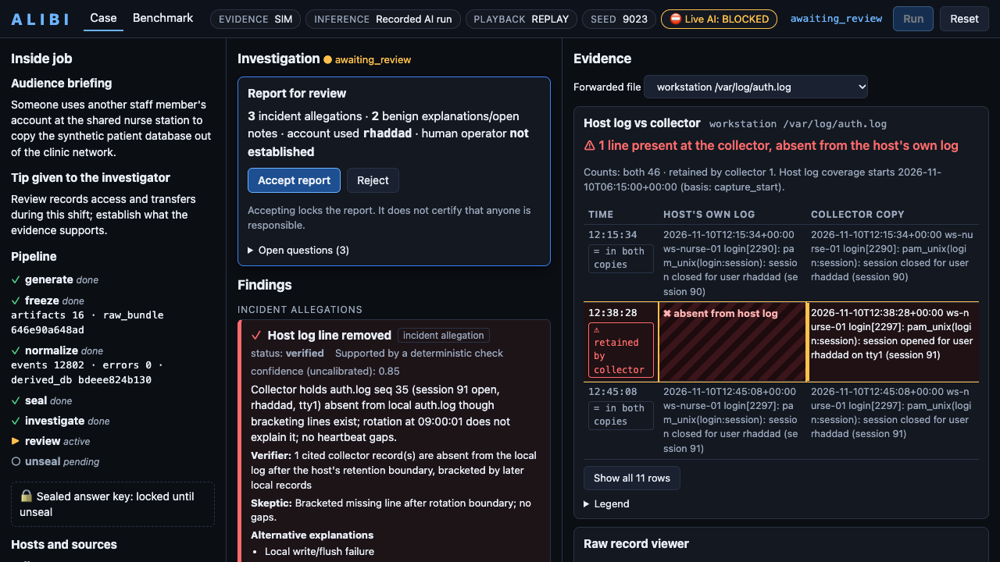
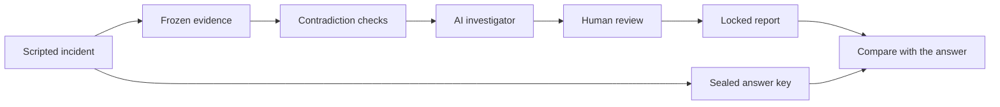

# ALIBI

**The log is missing. The evidence isn't.**

ALIBI is a practice range for digital investigations. It creates an incident, seals the answer key, and asks an investigator to reconstruct what happened from the evidence that survived. Every finding opens its source. The report is locked before anyone sees the answer.

Built at HackPrinceton Fall 2026 by Eric Chen, Rayan, Daniel, and Terry.



## Try it

Install [uv](https://docs.astral.sh/uv/) and Node 20 or newer. Then, from this repository:

```sh
uv sync --frozen
./start.sh
```

Open **http://127.0.0.1:8000**. Under **Recorded replays**, choose **Inside job · cover-up — Recorded AI run**, then press **Run**. Follow the missing log entry, open a citation, accept the report, and unseal the answer key.

The recording comes from a real Claude investigation. Playback needs no API key or internet connection once dependencies are installed. A fresh investigation without a configured key uses a clearly labeled scripted fixture.

Use `./start.sh --port 8010` if the default port is busy.

## What makes a case

A synthetic clinic has a workstation, a records server, a badge reader, a central log collector, and a network tap. An incident leaves traces across those systems. Some traces can be removed locally; independent copies survive elsewhere.

ALIBI compares those witnesses. A missing line can matter, but so can an ordinary log rotation or a broken collector. The investigator has to explain the difference—and keep an account name separate from the person who owns it.



Python checks establish observations. A LangChain DeepAgent plans the investigation, delegates work, considers alternatives, and writes a cited report. Its tools expose evidence, not the answer key. Human review locks the report; it does not certify a person's guilt.

## What runs today

- A repeatable simulator with one incident family and four kinds of benign control.
- Immutable evidence, provenance links, contradiction checks, report verification, and scoring.
- A real DeepAgents investigator with an integrity auditor, a skeptic, case notes, and a resumable review gate.
- An interactive case board and a saved real-model investigation that replays offline.

The incident generator is scripted. All current evidence is simulated. Real Linux capture, additional case families, and open-ended questions are implementation work in the [next-run plan](docs/next-run/CONTINUE.md), not current capabilities.

## Measured results

| Comparison | Result |
|---|---|
| Keyword recipe, 12 simulated cases | 16/20 incident effects; 0/4 cover-ups |
| Deterministic checks, same cases | 20/20 incident effects; 4/4 cover-ups |
| Single agent with checks, four-case AI pilot | 5/5 effects; estimated $0.50 total; median 19 seconds |
| Lead plus two specialists, same pilot | 5/5 effects; estimated $1.30 total; median 59 seconds |

The pilot found equal accuracy and a faster, cheaper single agent. These are small, simulator-specific measurements. They do not establish real-world accuracy or an advantage from delegation. [Results, methods, and saved reports](docs/benchmark.md).

## Live AI and development

Live inference uses a server-side Anthropic key. **The total API allowance is $20 across both runs, including the $2.92 already spent.** Follow [API setup](docs/next-run/API_SETUP.md); preserve the existing spend ledger.

Every model call goes through one budget gateway. It counts the outgoing request before sending it, refuses one that is too large or cannot be counted, reserves tokens and money so parallel agents cannot jointly pass a cap, and keeps the worst-case cost of any call whose billing outcome is unknown until someone reconciles it. Automatic calls stop $0.50 short of the cap. The totals are a conservative estimate at list prices, not a bill; the provider console is the billing authority.

```sh
uv run alibi runtime
uv run alibi spend
uv run pytest
npm --prefix web run build
```

Tests use fixtures and do not need a model key. Browser tests require installed Google Chrome and a built UI. Do not run the paid pilot just to check the installation.

## Read more

- [Architecture](docs/architecture.md) · [claims and supporting evidence](docs/claims.md)
- [Two-minute demo](docs/demo-script.md) · [judge questions](docs/judge-qa.md)
- [Build history](PROGRESS.md) · [engineering decisions](DECISIONS.md)
- **Team:** [start the next run](docs/next-run/START_HERE.md) · [owners and schedule](docs/next-run/TEAM.md)

`src/alibi/` contains the backend; `web/` the React case board; `tests/` the checks; `benchmarks/` the measured results; and `demo/replays/` the recordings.
